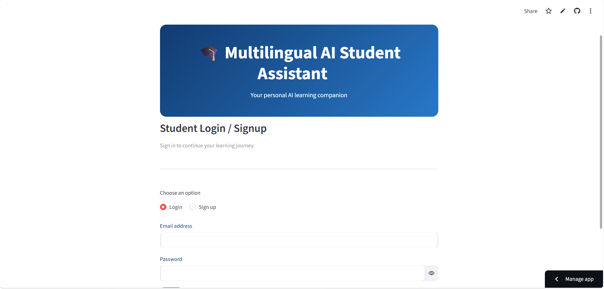
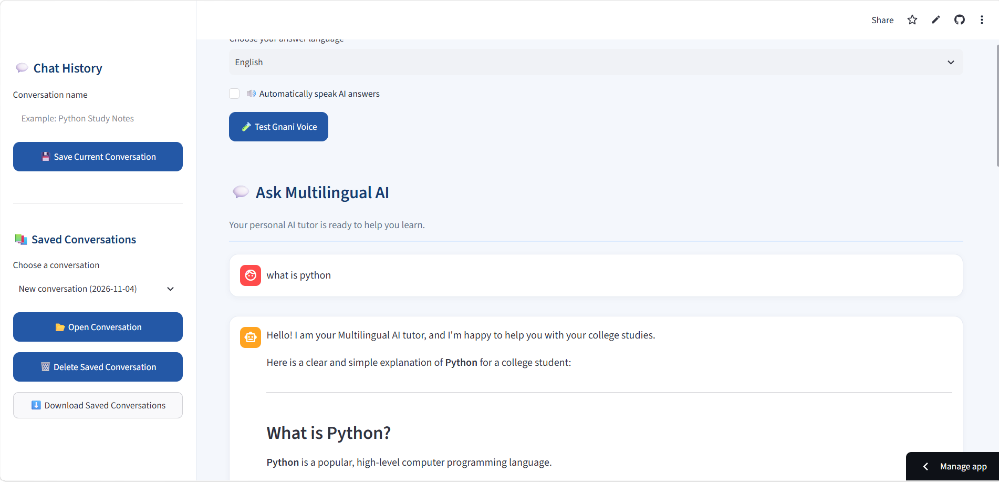

# 🎓 Gnani AI Multilingual Student Assistant

An AI-powered, multilingual student assistant built with Python and Streamlit. The application helps students explore academic topics, understand AI concepts, and access study support and career guidance through text and voice interaction.

🌐 **Live Demo:** [Try the application](https://multilingual-ai-student-assistant-vdcadubd28bnnxfep9jqig.streamlit.app/)

💻 **Source Code:** [GitHub Repository](https://github.com/koramutlacharansai7-crypto/multilingual-ai-student-assistant)

## 📌 Project Overview

The Gnani AI Multilingual Student Assistant combines generative AI, speech recognition, text-to-speech, and database integration to provide an accessible learning experience.

Students can ask questions, receive AI-generated responses, interact through voice input, listen to spoken answers, and revisit saved conversations.

## ✨ Key Features

- **AI-powered student chat:** Get assistance with academic questions, AI concepts, study topics, and career guidance.
- **Voice input:** Ask questions using a microphone.
- **Speech-to-text:** Convert spoken questions into text using Gnani AI.
- **AI-generated answers:** Generate responses using the Google Gemini API.
- **Multilingual support:** Interact in English, Tamil, Telugu, and Hindi.
- **Text-to-speech:** Convert AI-generated responses into audio using Gnani AI.
- **Audio playback:** Listen to generated answers.
- **Student authentication:** Sign in to access the application.
- **Conversation history:** Save, reopen, and continue previous conversations.
- **Persistent storage:** Store conversation data in Supabase so it can remain available after refreshing or signing in again.
- **Conversation separation:** Keep separate conversations organized independently.
- **Cloud deployment:** Access the application through its Streamlit Community Cloud URL.

## 🛠️ Technologies Used

| Technology                | Purpose                                         |
| ------------------------- | ----------------------------------------------- |
| Python                    | Application development                         |
| Streamlit                 | Web application interface                       |
| Google Gemini API         | AI-generated responses                          |
| Gnani AI Speech-to-Text   | Voice recognition                               |
| Gnani AI Text-to-Speech   | Speech generation                               |
| Supabase                  | Database and student authentication integration |
| Requests                  | API communication                               |
| python-dotenv             | Local environment variable management           |
| Streamlit Community Cloud | Application deployment                          |
| GitHub                    | Source code management and version control      |

## 🌍 Supported Languages

- English
- Tamil
- Telugu
- Hindi
- Kannada
- Malayalam

## 🏗️ Application Workflow

1. A student opens the web application and signs in.
2. The student enters a question using text or voice.
3. Voice input is converted into text using Gnani AI.
4. The question is processed using the Google Gemini API.
5. The generated response is displayed in the application.
6. The student can listen to the response using Gnani AI text-to-speech.
7. Conversation history is saved through Supabase for later access.

## ⚙️ Run the Project Locally

### Prerequisites

- Python installed on your computer
- A GitHub account to obtain the source code
- Required API credentials for Google Gemini and Gnani AI
- Supabase project credentials

### 1. Clone the repository

```bash
git clone https://github.com/koramutlacharansai7-crypto/multilingual-ai-student-assistant.git
```

### 2. Open the project directory

```bash
cd multilingual-ai-student-assistant
```

### 3. Install dependencies

```bash
python -m pip install -r requirements.txt
```

### 4. Configure environment variables

Create a local `.env` file and configure the environment variable names expected by the application for:

- Google Gemini API credentials
- Gnani AI API credentials
- Supabase project URL
- Supabase API credentials

Use the variable names already referenced in `app.py`. Never publish real API keys or passwords.

### 5. Start the application

```bash
python -m streamlit run app.py
```

Open the local URL displayed in the terminal.

## ☁️ Deployment

The application is deployed using Streamlit Community Cloud.

**Live application:**
[https://multilingual-ai-student-assistant-vdcadubd28bnnxfep9jqig.streamlit.app/](https://multilingual-ai-student-assistant-vdcadubd28bnnxfep9jqig.streamlit.app/)

The deployed application uses configured secrets and environment variables for its external service integrations.

## 🔐 Security and Privacy

- Do not commit `.env` files or API keys to GitHub.
- Store deployment credentials using Streamlit Community Cloud secrets.
- Use Supabase Row Level Security (RLS) and appropriate user-scoped policies to restrict access to individual students' conversation data.
- Never expose private credentials in source code, screenshots, or public documentation.
- If a secret has previously been committed publicly, rotate the affected credential and address its presence in Git history.

## 🎯 Project Objectives

- Make AI-powered learning assistance more accessible.
- Support multilingual text and voice interaction.
- Provide a convenient way for students to ask questions and revisit previous conversations.
- Explore the integration of generative AI, speech technologies, cloud deployment, and database services in a practical application.

## 🎓 Learning Outcomes

This project provides practical experience with:

- Python application development
- Generative AI API integration
- Speech recognition and speech synthesis
- Multilingual user interaction
- Streamlit web development
- Database integration and authentication
- Environment variable and API credential management
- Cloud deployment and GitHub version control

## 📸 Application Screenshots

### Home Page


### AI Chat


### Voice Assistant


